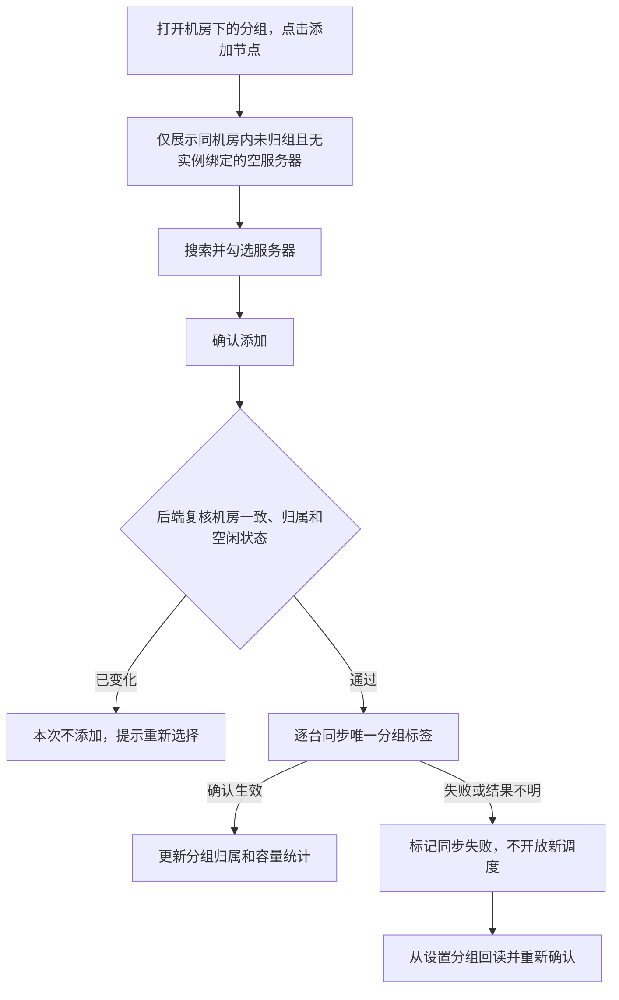
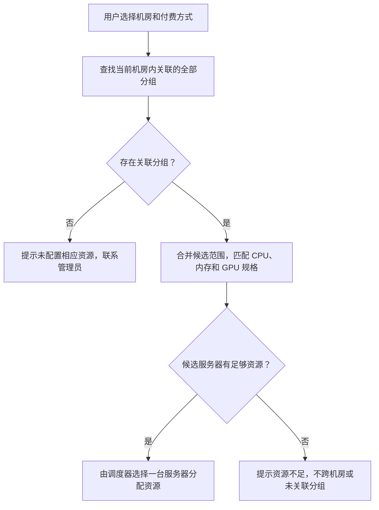

# 资源分组与服务器调度规则

资源分组属于机房：运营先选择机房，创建分组并关联付费方式，再向分组添加同机房的服务器节点。一个分组只属于一个机房，可关联多种付费方式；一台服务器只能属于同机房的一个分组。以下为产品规则及交互演示，尚未对接真实 Cloud Pod。

## 机房归属

- 分组实体新增必填的 `roomId`。列表和详情展示所属机房；创建后不提供变更机房入口。
- 从机房管理点击「查看资源分组」，只查看该机房的分组；创建时默认带入当前机房。全局「资源分组」入口支持按机房筛选，从这里创建时须先选择机房。
- 同机房内分组名称唯一，不同机房可使用相同的展示名称；分组 ID 保持独立唯一。后端仍须按 Cloud Pod 实际唯一性范围处理拼音标签重名。
- 机房里的分组 GPU 数量，只统计归属该机房且标签确认生效的成员服务器，不能跨机房合并库存。

## 分组配置

| 分组示例 | 关联付费方式 | 目标 |
| --- | --- | --- |
| 预约保障组 | 按课表付费 | 将整台服务器的资源用于课表云电脑 |
| 按需弹性组 | 计时付费、包周期付费 | 将整台服务器的资源用于日常按需使用 |

- 创建分组时先选择机房，再填写名称，并至少选择一种付费方式，支持多选。名称去除首尾空格后为 2–128 个字符，支持中文、英文字母、数字和连字符（-）；须以中文或英文字母开头，不能以连字符结尾，同机房内不可重名。分组有独立且稳定的 ID。
- 中文展示名称保留。后端采用拼音或拼音首字母生成 Cloud Pod 调度标签名称，转换后须满足 2–128 位英文字母、数字和连字符、字母开头、不以连字符结尾的规则，并校验底层要求的唯一性。不同中文名称可能生成相同拼音或首字母，不能仅依据展示名称判定标签唯一。原型不调用真实汉字转换服务，标签仍为演示占位值。
- 分组不绑定某所高校。当前通过付费方式划分用途，预约保障组可以服务多个学校。预留容量由运营按机房、GPU 型号人工确认，不增加课表容量自动拦截。
- 同一种付费方式可关联多个分组。先限定用户选择的机房，再将该机房内关联此付费方式的分组合并为候选范围，按硬件规格和可用资源调度；分组之间不增加优先级，也不默认选列表第一组。
- 同时关联多种付费方式，意味着这些付费方式可以共享组内资源。若要隔离课表容量，应采用上表的两个独立分组配置，不能把计时付费也关联到预约保障组。

## 添加节点与设置分组

- 「添加节点」支持复选，仅列出分组所属机房内无实例绑定、GPU 已卸载、未归组且分组状态已确认的服务器。其他机房、已有其他分组或已在本组的服务器不再出现在候选中。支持按服务器名称和 ID 搜索，全选仅作用于当前搜索结果，已选项跨搜索保留。
- 「无实例」不是「在线实例为 0」。运行实例、已关机但仍绑定的实例、纯 CPU 实例均计入绑定数；GPU 尚在卸载时也不可添加。
- 保存时后端重新检查分组机房与服务器机房一致，再检查实例绑定、设备状态和分组归属。若跨机房或状态变化，本次校验不通过，提示重新选择；不能只依赖弹窗打开时的前端数据。
- 服务器列表仍保留「设置分组」，仅空服务器可操作，目标选项只显示该服务器所在机房的分组。选择后替换其唯一分组归属；不能借此改变服务器所属机房。仅名称变更不能改变服务器调度标签。
- 每台服务器的成员归属变更必须串行处理。数据库对服务器归属保持唯一约束；并发添加同一服务器时，只能有一个请求成功，另一个返回状态已变化。
- 分组成员数据和 Cloud Pod 标签需要一起确认：同步中及结果不明的服务器不计入已生效容量，也不应接受新调度。每台服务器显示同步结果；多选添加若出现部分同步失败，按节点展示并从「设置分组」重新确认。
- 调度标签代表服务器粒度的整机分组。分组 ID、展示名称与底层标签分别存储映射；标签名称由后端按已确认的拼音或拼音首字母规则生成。原型代码中的标签字符串仅用于演示，真实标签字段及写入方式由研发与 Cloud Pod 接口核对。
- 数据库唯一约束只能防止重复归组，不能单独解决标签写入与开机分配之间的竞争。正式接入前，研发需验证当前 Cloud Pod 版本的宿主机调度开关、在途任务和标签生效时机，确保空闲复核到标签生效之间不会被插入新分配。原型中的异步成功反馈不代表底层已具备该保证。

## 租户购买与调度

租户保持现有机房和购买方式选择，不增加选组步骤。新建分配时，系统以「所选机房 + 付费方式」查找全部关联分组，将符合要求的成员服务器作为候选，交给调度器按 GPU 型号、卡数、CPU、内存等约束选择。这里定义的是候选范围，不假定 Cloud Pod 的多标签条件天然等价于多组并集。

| 场景 | 产品规则 |
| --- | --- |
| 一个分组关联多种付费方式 | 各付费方式共享该组服务器资源，没有隐含的各自保留额度 |
| 同机房的一种付费方式关联多个分组 | 所有关联组均可参与新建分配，由调度器选择服务器，不固定选第一组 |
| 某候选组资源不足 | 可使用同机房内其他关联组的合法资源，不跨机房或借用未关联的组 |
| 未配置关联组 | 提示「当前机房暂无支持此付费方式的资源，请联系管理员」 |
| 关联组均无匹配资源 | 提示当前机房对应规格资源不足，不允许无卡降级启动 |
| 已创建计时机再次开机 | 只在原服务器内重新申请 GPU，不能按新建流程切换到其他组或服务器 |

研发需确认 Cloud Pod 能否按上述候选范围调度。若接口一次只能限定一个分组，则由业务调度层完成选组及容量变化后的重新尝试，不能把「只选第一组」或标签条件错误地求交集作为产品规则。调度失败后重试必须确认上次未成功分配，避免重复创建实例或占用 GPU。

- **课表机：** 到达上课时间才可开机；下课关机并释放 GPU。关机后若仍保留宿主机绑定，该服务器仍不满足设置分组条件。
- **计时机：** 关机释放 GPU，保留实例和原宿主机绑定。再次开机只申请原服务器内符合规格的空闲 GPU，不跨服务器迁移。原服务器不足时保持关机并提示原因；不能因为其他组有空卡而越组调度。
- **包周期付费：** 本次补充分组关联能力，不推定其关机卸卡、计费和实例到期规则与计时机相同。这些行为按该产品已确认规则执行。
- **纯 CPU 规格：** 在宿主机支持该规格的前提下复用购买方式对应的分组，GPU 请求量为 0；不另建纯 CPU 共享池。
- **GPU 容量：** 按机房、分组、型号分别统计，故障 GPU 不计入可用容量。服务器内所有 GPU 归属该服务器的唯一分组。单个分组包含多种型号时，指定型号的实例只能使用满足该型号和卡数要求的设备。
- **新增服务器：** 默认未分组，在确认分组标签前不参与分组调度。存量有效归属按实际状态回读展示，不能因添加机房而自动把服务器归入某个组。
- **数据保护：** 用户在自动释放期限内申请开机，后端确认因 GPU 不足而失败时，需按已确认的资源不足保护规则处理，暂停自动释放并转人工处理，不能让此次失败直接造成实例及数据被删除。

## 原型验证范围

机房下创建分组、机房筛选、同机房节点搜索与复选、跨机房归组拦截、实例绑定校验、异步反馈和容量统计为本地交互演示；数据刷新后重置。增加「演示机房B」用于验证跨机房隔离，并不代表新增真实机房。默认展示 RTX 4090、L40S、A10 三种 GPU 型号，按机房和型号分别统计数量和分组归属；「未分组」独占一行。未实现真实多组调度、包周期计费或跨主机迁移。
