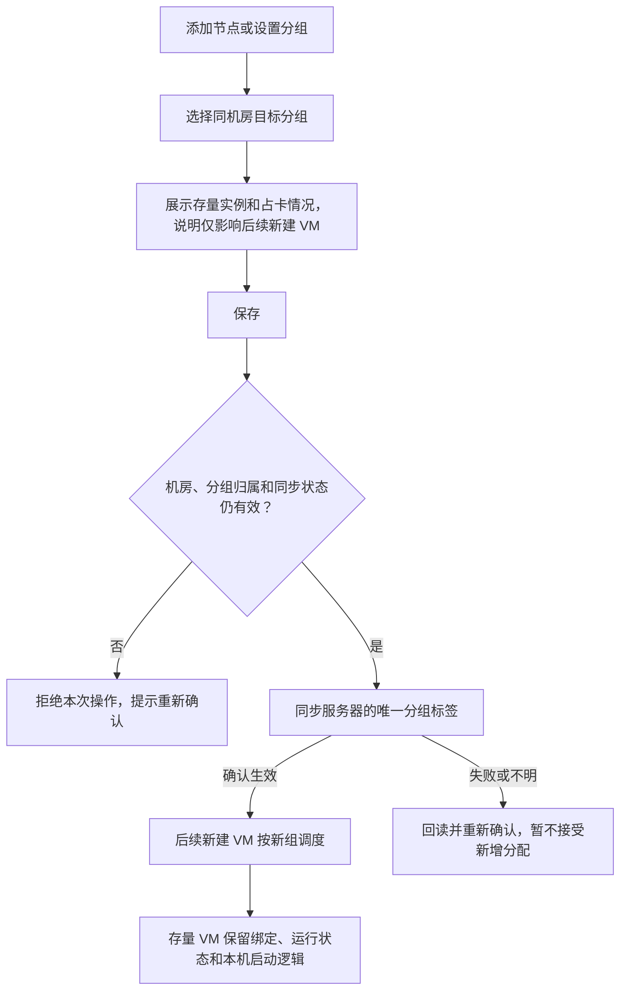
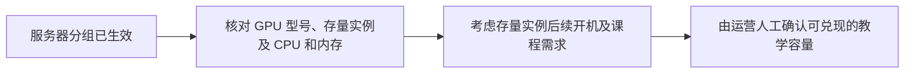
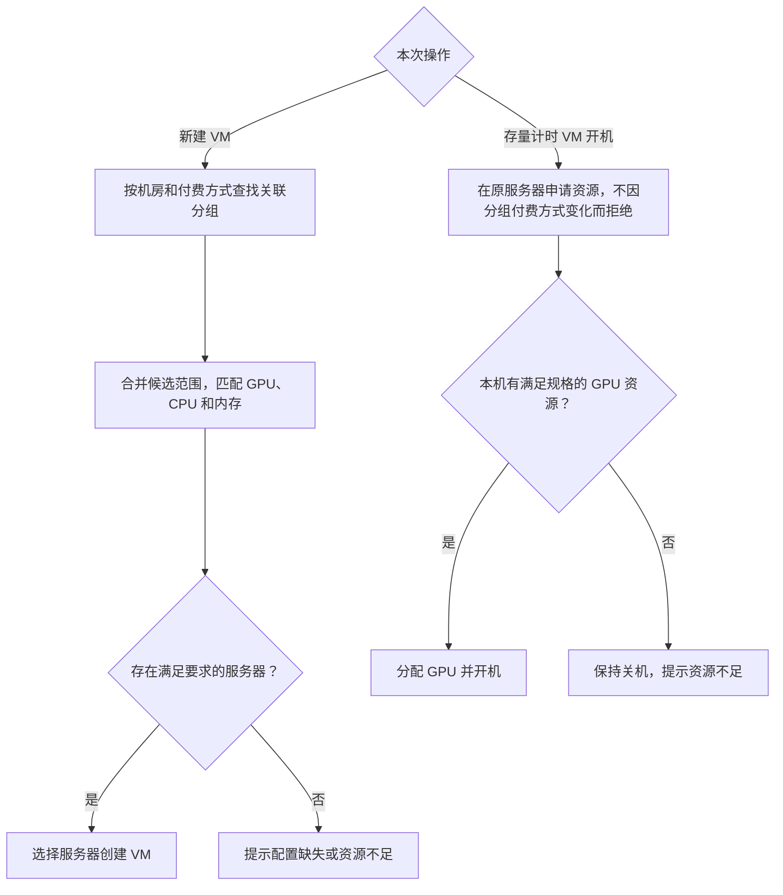

# 资源分组与服务器调度规则

资源分组属于机房，用于确定后续新建 VM 的服务器候选范围。付费方式用于创建时选池，不是对存量 VM 的启动权限限制。允许服务器带存量实例、GPU 占用或卸卡任务设置分组。

**分组设置成功与教学容量预留完成是两件事。** 本版不增加“教学预留已完成”的自动状态，也不因换组关机、迁移、解绑或删除已有实例；教学保障容量继续由运营人工确认。

## 机房和分组

- 分组具有独立 ID、必填的所属机房 `roomId`、名称、关联付费方式。一个分组只属于一个机房，一台服务器只能属于同机房的一个分组。
- 创建时先选机房；从机房管理进入「查看资源分组」，只展示当前机房的分组，创建时默认带入该机房。全局入口支持按机房筛选。
- 同机房内展示名称唯一，不同机房可同名。名称去除首尾空格后为 2–128 个字符，支持中文、英文字母、数字和连字符，须以中文或英文字母开头，不能以连字符结尾。
- 后端按拼音或拼音首字母生成底层标签名称，再按 Cloud Pod 要求校验格式、长度和唯一性。展示名、分组 ID、底层标签分别存储映射。原型标签为演示占位，不执行真实汉字转换。
- 分组关联至少一种付费方式，允许多选。不同付费方式若关联同一分组，则共享该组的新建资源候选范围。

| 配置示例 | 新建 VM 适用付费方式 |
| --- | --- |
| 预约保障组 | 按课表付费 |
| 按需弹性组 | 计时付费、包周期付费 |

## 添加节点和设置分组

- 「添加节点」支持搜索与复选，候选范围为同机房内未归组、分组同步状态已确认的服务器。允许存在运行、关机或纯 CPU 实例，也允许 GPU 正在使用或卸载。已有其他分组的服务器从「设置分组」变更，不能重复加入。
- 添加候选显示绑定实例数、GPU 总量和当前 GPU 占用，供运营判断；这些数值不作为保存的阻断条件。
- 「设置分组」不再要求绑定实例为 0，也不要求 GPU 无占用或已卸载。目标只提供同机房的分组；未改变目标时不可重复保存，同步中不可并发发起另一项变更。
- 保存时再次核对机房一致、当前分组归属及同步状态，添加节点还需确认服务器仍未归组。实例数和 GPU 使用状态变化不导致本次设置被拒绝。
- 存在存量实例时，设置弹窗展示实例数、当前占卡数及影响说明，允许直接保存，不额外增加二次确认。
- 每台服务器的归属变更需串行处理，数据库保持服务器归属唯一。页面以底层标签确认结果更新生效归属，不能只改页面或数据库而不校验底层结果。
- 同步失败或结果不明时，保留最近确认的归属与目标记录；该服务器暂不作为新建 VM 的候选，运营从「设置分组」回读并重新确认。不得为此阻断存量 VM 的正常启动；不能直接假定禁用整台宿主机符合这个要求，实际接口能力由研发验证。
- 变更生效前已被受理的在途新建任务可能在之后完成，应明确记录其归属并按存量实例处理，不自动销毁。生效后的新建请求按新组路由；标签同步、缓存更新和在途任务的生效边界由研发明确，不能承诺标签变更会自动取消旧任务。

## 分组生效与教学保障容量

| 显示口径 | 含义 |
| --- | --- |
| 服务器数量 | 当前分组已确认生效的成员服务器数 |
| GPU 总量 | 这些服务器上的物理 GPU 总数，包括当前占用和故障设备 |
| 当前 GPU 占用 | 此刻被使用的 GPU 数量，不能据此推断实例属于哪种付费方式 |
| 当前 GPU 空闲 | 此刻可见的空闲设备数量，不含卸载中或故障设备；不表示未来课时时段已预留 |
| 绑定实例 | 当前仍绑定这些服务器的实例，包括关机和纯 CPU 实例 |
| 教学保障容量 | 运营结合存量实例后续使用、GPU 型号、故障、CPU、内存及课程需求人工确认，不由分组总量自动推算 |

分组仅改变新增 VM 的进入方向，组内可以继续存在原组创建的实例。即使旧计时 VM 当前关机，其后仍可能申请本机 GPU，所以实时空闲不等于整机教学容量已兑现。

例如：8 张卡的服务器绑定 3 台各需 1 张卡的计时 VM。改入课表组后，运行中的旧计时 VM 继续使用；关机中的旧计时 VM 仍可尝试在原服务器开机。课表机和旧计时机可能竞争本机资源，不能仅凭“已加入预约保障组”就承诺 8 张卡全部保障教学。运营可协调存量实例使用或后续处置，再确认教学容量；本版不自动释放或迁移用户实例。

## 新建 VM 与存量 VM 分开处理

租户仍只选择机房、付费方式和规格，不增加选组步骤。新建 VM 先限定机房，再查找关联付费方式的全部分组，形成候选服务器范围，由调度器选择满足规格和容量要求的服务器。不设组间优先级，不固定选第一组，也不使用未关联的其他分组。

若某候选组不足，可使用同机房其他关联组的合法资源。若没有关联组，提示配置缺失；全部候选均不足，提示资源不足，不允许无卡降级启动。Cloud Pod 多标签是否可直接表达候选并集需研发确认，不能错误求交集。若业务层需按组尝试，必须先确认上次未成功分配，避免重复创建和占卡。

- **课表机：** 仍按现有课表时段开机，下课关机、还原系统盘并释放 GPU；分组变更本身不改变这些行为。
- **计时机：** 关机释放 GPU，保留实例和原服务器绑定；再次开机仅申请原服务器的符合规格的空闲 GPU。换组后不因目标组未关联计时付费而拒绝存量 VM 开机，不跨服务器迁移。资源不足时保持关机，执行已确认的资源不足保护规则。
- **纯 CPU 实例：** 新建时复用相应机房及付费方式的候选范围；存量实例不因换组被关闭或解绑。其 CPU、内存占用仍影响新 VM 的实际可分配容量。
- **包周期付费：** 本次仅明确选池规则，不推定其计费、到期及关机卸卡规则与计时机相同。
- **未分组服务器：** 不参与按分组的新建分配，但仍须保留既有实例的运行和本机开机逻辑。

## 原型验证范围

原型支持机房归属、付费方式多选、带存量实例设置分组和添加节点、同机房唯一归属校验、同步反馈，以及 GPU 总量、实时占用和空闲的展示。实例绑定及 GPU 状态在换组时保持不变。演示机房B及各型号数量均为模拟数据；刷新后重置。未实现真实 Cloud Pod 标签同步、多组调度、汉字转写、教学容量自动预留或跨主机迁移。
